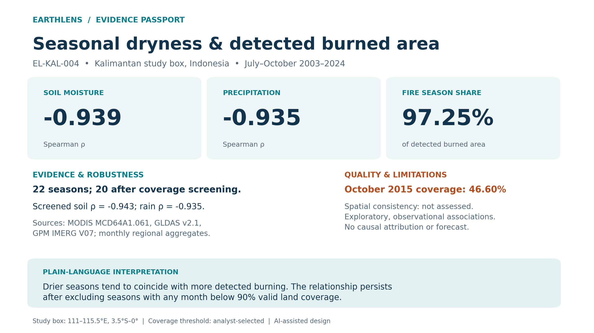

# EarthLens | Scientific handoff
Everything Everywhere — NASA Space Apps Challenge 2026

## Research question
How have air temperature, precipitation, surface soil moisture and detected burned area changed in the Kalimantan study box, and how are seasonal water deficits associated with detected burned area?

## Data and scope
Requested bounding box: west 111, south -3.5, east 115.5, north 0 (degrees). This is a rectangular study area, not an administrative boundary. Giovanni products use different native grid footprints, documented in original CSV headers; climate averages and land-only burned-area totals are not spatially identical. Monthly archive: January 2003–December 2025. Rainfall ends September 2025; missing values remain blank. All primary comparisons use complete years 2003–2024 (22 years).

| Input | Product | Units | Access |
|---|---|---|---|
| rain | GPM IMERG Final GPM_3IMERGM v07 | mm/month | https://gpm.nasa.gov/data/imerg |
| temp | MERRA-2 M2TMNXSLV v5.12.4 T2M | Celsius | https://gmao.gsfc.nasa.gov/reanalysis/MERRA-2/ |
| soil | GLDAS_NOAH025_M v2.1 SoilMoi0_10cm_inst | kg/m² | https://ldas.gsfc.nasa.gov/gldas |
| burned_area_km2 | MODIS MCD64A1.061 | km² | https://developers.google.com/earth-engine/datasets/catalog/MODIS_061_MCD64A1 |

Climate extraction: https://giovanni.gsfc.nasa.gov/giovanni/ ; exact query URLs in raw CSV headers. Burned area extraction: Earth Engine monthly native-grid pixel-area sum, BurnDate > 0, QA bit 0 land and bit 1 valid. Coverage = valid_land_km2 / land_area_km2. Monthly totals summed across months can include repeat burns; not unique annual footprint. Coverage measures valid retrieval area, not detection accuracy.

## Reproduction
Install dependencies: `pip install -r requirements.txt`, then `python analyze.py` in this directory. Raw source CSVs are included in `data/raw/`. No imputation. Dates joined one-to-one. Annual and July–October precipitation/burned area summed, temperature/soil arithmetic means of monthly values. Monthly anomalies are departures from the corresponding calendar-month mean over 2003–2024. July–October was identified from observed fire seasonality, so seasonal tests are exploratory.

Trends: OLS slopes per decade, conventional p-values, HAC standard errors (Bartlett, lag 2, t reference), nominal Kendall and Sen slopes. BH adjustment across four HAC trend p-values. HAC is an approximate sensitivity check with 22 observations, not a guarantee of temporal independence; lag choice is exploratory. Spearman associations have nominal p-values, not autocorrelation-adjusted. Seasonal sensitivity excludes whole years when any July–October month is below 90% or 80% valid MODIS coverage; thresholds are analyst choices, not NASA standards.

## Results
- Warming +0.262 °C/decade, HAC 95% CI +0.099 to +0.425, p=0.00316, BH q=0.01264. No significant annual rain or soil trend under these tests.
- Burned-area trend -1692 km²/decade: conventional OLS p=0.118, Kendall p=0.062, HAC p=0.00717. Method-sensitive, not a definitive decline; coverage and skewness matter.
- 97.25% of detected burned area occurred July–October. Seasonal Spearman rho: soil -0.939, rainfall -0.935, temperature -0.027. At >=90% coverage in every seasonal month (20 years), rho = -0.943, -0.935, +0.011 respectively. Associations are not causal.
- October 2015 valid land coverage 46.60%; do not infer absence of fires from missing retrievals. 8 months below 90% during 2003–2024.

## Integration files
- `data/monthly.csv`: dates, four variables, valid/total land area, coverage fraction (0–1).
- `data/annual.csv`, `data/seasonal.csv`: yearly aggregates; coverage is minimum monthly fraction in the period.
- `data/monthly_anomalies.csv`: monthly values and calendar-month anomalies.
- `results/trends.csv`, `results/associations.csv`: calculated statistics, sample sizes and sensitivity tests.
- evidence.json: machine-readable regional Evidence Passport inputs. Keep numeric values fixed; any AI explanation should use only these metrics and their limitations.

## Limitations and scope
GLDAS and MERRA-2 are modeled/reanalysis products; shared meteorological inputs can introduce dependence. Surface soil moisture is not peat water-table depth. No attribution or wildfire forecast is demonstrated. Spatial consistency, global dynamic retrieval and vegetation NDVI/EVI are not implemented in this package. NDVI export failed and is excluded. Neighboring cells cannot be treated as independent evidence. Do not describe regional averages as pixel-level results.

## AI disclosure
ChatGPT assisted with code drafting, statistical analysis and documentation; results were computed deterministically using the supplied NASA files. Team should review code, verify conclusions and declare AI assistance according to submission requirements.

## Presentation assets

[Warming](figures/01_warming.png) · [Fire season](figures/02_fire_season.png) · [Associations](figures/03_seasonal_associations.png) · [Data quality](figures/04_data_quality.png).
